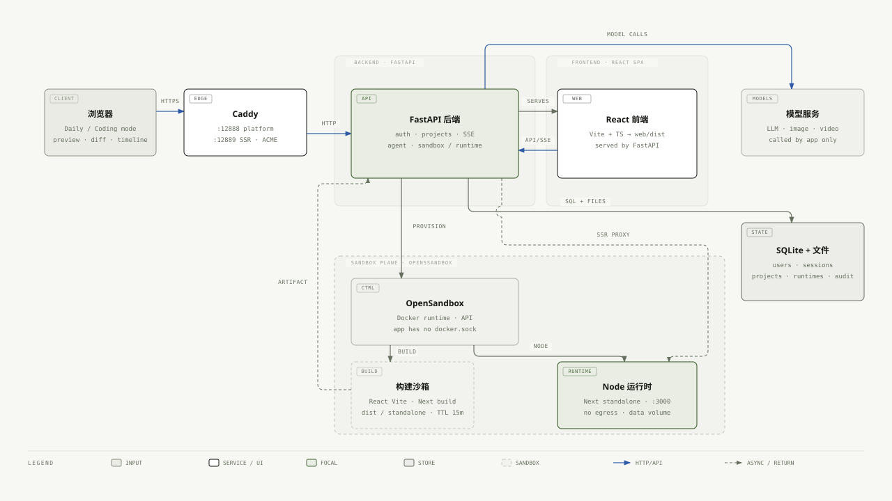

# Reify

> 一句话生成网站、简历、小游戏、旅游攻略、图片、视频和编程演示，并直接部署为可访问的页面。

**简体中文** | [English](README.en.md)

Reify 是一个生成式设计 Agent：用户用一句话描述需求，Reify 负责规划、生成、校验，并把结果部署成可访问的页面；过程通过 SSE 实时展示。

- 内容能力：网站、简历、小游戏、旅游攻略、图片、视频和编程演示
- 自动选择技术栈：静态 HTML / Vite React / Next.js，用户无需理解构建细节
- 多用户账号、项目隔离、实时进度、Refine、分享和导出
- 生成内容在独立沙箱中构建和运行

## 架构



Reify 按职责分为六层：

| 层 | 主要组成 | 作用 |
|---|---|---|
| 交互层 | React + Vite 工作台 | 输入需求、查看规划/代码 Diff/事件流、管理项目 |
| 接入与控制层 | Caddy、FastAPI、认证与配额 | TLS/反向代理、账号会话、项目 API、SSE、分享与审计 |
| 编排与生成层 | Agent 编排、生成与校验 | 把需求拆成计划，生成页面或应用，并执行结构与离网自检 |
| 构建层 | OpenSandbox 构建沙箱 | 对 React/Next 源码执行依赖安装与构建，校验后回传产物 |
| 运行时与发布层 | 项目运行时、Next SSR 运行时 | 静态/React 项目提供 `/p/`、`/s/`，Next 项目提供 `/apps/` |
| 数据层 | SQLite、项目工作区、运行时记录 | 用户、会话、项目元信息、事件、产物与运行状态 |

## 快速开始

前置条件：

- Python 3.12+（验证到 3.14）
- Node.js 20+（推荐 24）与 npm
- 可选：Docker + OpenSandbox，仅 React/Next 源码构建需要
- 可选：OpenAI 兼容模型接口

```bash
# 1. 构建平台前端，产物输出到 web/dist
cd frontend
npm ci
npm run build
cd ..

# 2. 创建 Python 环境
python3 -m venv .venv
.venv/bin/pip install -r requirements.txt

# 3. 启动
REIFY_ADMIN_PASSWORD=your-password \
.venv/bin/python -m uvicorn server.main:app --host 127.0.0.1 --port 7801
```

打开 <http://127.0.0.1:7801>。管理员用户名默认 `admin`；未设置密码时，启动日志会输出随机密码。

`./run.sh` 会自动创建 venv、安装依赖并在 `0.0.0.0:12888` 启动，但不会构建前端；首次运行仍需执行上面的第 1 步。

### 前端开发模式

```bash
cd frontend
npm run dev
# 默认 http://127.0.0.1:5173
# 后端不在 7801 时：
REIFY_BACKEND=http://127.0.0.1:12888 npm run dev
```

### 启用源码构建沙箱（可选）

React/Next 源码需要 Docker 与 OpenSandbox Server：

```bash
uvx opensandbox-server init-config ~/.sandbox.toml --example docker
uvx opensandbox-server --config ~/.sandbox.toml

REIFY_SANDBOX=opensandbox \
REIFY_SANDBOX_DOMAIN=127.0.0.1:8080 \
REIFY_SANDBOX_API_KEY=your-sandbox-key \
REIFY_SANDBOX_BUILD_MEMORY=4Gi \
REIFY_SSR_PREVIEW=1 \
.venv/bin/python -m uvicorn server.main:app --host 127.0.0.1 --port 7801
```

未启用沙箱时，React/Next 请求会回退到静态模板，其他能力不受影响。

## 构建镜像

```bash
docker build -t reify-app:latest -f Dockerfile.app .
```

镜像为两阶段构建：Node 阶段构建 `frontend/`，产物 `web/dist` 复制进 `python:3.12-slim` 运行镜像。

## 测试

```bash
# 测试依赖
.venv/bin/pip install -r requirements-dev.txt

# 后端单测
.venv/bin/python -m pytest -q

# 前端单测、类型检查、构建
cd frontend && npm test && npm run typecheck && npm run build && cd ..

# 生成工程的 TypeScript 真实构建（npm ci + tsc + vite/next build）
.venv/bin/python tests/e2e_typescript_scaffolds.py

# 全链路 UI（真实 uvicorn + Chrome + mock LLM，无需沙箱）
.venv/bin/python tests/e2e_browser.py
```

浏览器 E2E 使用系统 Google Chrome。源码沙箱相关用例需要可用的 OpenSandbox：

```bash
.venv/bin/python tests/e2e_react_sandbox.py
.venv/bin/python tests/e2e_next_ssr.py
.venv/bin/python tests/e2e_refine.py
```

已部署实例的回归用例通过 `REIFY_E2E_BASE` 指定地址；`*_live.py` 会调用真实模型并消耗 token：

```bash
REIFY_E2E_BASE=https://your-host:12888 .venv/bin/python tests/e2e_deployed.py
REIFY_E2E_BASE=https://your-host:12888 .venv/bin/python tests/e2e_next_live.py
REIFY_E2E_BASE=https://your-host:12888 .venv/bin/python tests/e2e_game_live.py
REIFY_E2E_BASE=https://your-host:12888 .venv/bin/python tests/e2e_longtail_live.py
```

## 目录结构

```text
.
├── frontend/              Vite + React 19 + TypeScript 控制台
│   └── src/               api / auth / pages / features / hooks / styles
├── server/                FastAPI 后端
│   ├── main.py            API、SSE、SPA 服务与鉴权
│   ├── agent.py           生成编排：规划 → 写文件 → 自检 → 部署
│   ├── llm.py             模型调用：brief、Refine、长尾生成
│   ├── media.py           图片/视频生成
│   ├── sandbox.py         OpenSandbox 构建与产物校验
│   ├── runtime.py         Next standalone 运行时
│   └── templates/         静态模板、React/Next 脚手架、游戏引擎
├── web/dist/              前端构建产物，由 FastAPI 直接服务
├── tests/                 pytest 单测与 E2E 脚本
├── data/                  运行时数据：SQLite、用户工作区（不提交）
├── docs/                  设计文档
├── Dockerfile.app         多阶段构建：前端 + Python 运行镜像
├── Caddyfile              HTTPS 与 SSR 反代配置
├── deploy_remote.sh       远程部署脚本
├── run.sh                 本地启动脚本
├── requirements.txt       生产依赖
├── requirements-dev.txt   测试依赖
└── .env.example           环境变量样例
```

## 关键环境变量

| 变量 | 默认 | 说明 |
|---|---|---|
| `REIFY_HOST` / `REIFY_PORT` | `0.0.0.0` / `12888` | 监听地址与端口 |
| `REIFY_DATA` | `./data` | SQLite 与用户工作区根目录 |
| `REIFY_DB` | `data/reify.db` | SQLite 路径 |
| `REIFY_ADMIN_USER` / `REIFY_ADMIN_PASSWORD` | `admin` / 随机 | 首个管理员；密码为空时启动随机生成 |
| `REIFY_REGISTRATION` | `open` | `open` 或 `closed` |
| `REIFY_COOKIE_SECURE` | `0` | HTTPS 部署必须设为 `1` |
| `REIFY_LLM_ENABLED` | `1` | 是否启用模型；配置了 BASE_URL 才生效 |
| `REIFY_LLM_BASE_URL` / `REIFY_LLM_API_KEY` / `REIFY_LLM_MODEL` | 空 | OpenAI 兼容接口 |
| `REIFY_LLM_LONGTAIL_MAX_TOKENS` | `24000` | 长尾生成输出上限 |
| `REIFY_MEDIA_API_BASE` / `REIFY_MEDIA_API_KEY` | 继承 LLM | 图片/视频接口 |
| `REIFY_SANDBOX` | `off` | `opensandbox` 启用源码构建 |
| `REIFY_SANDBOX_DOMAIN` | `127.0.0.1:8080` | Sandbox Server 地址 |
| `REIFY_SANDBOX_API_KEY` | 空 | Sandbox API Key |
| `REIFY_SANDBOX_BUILD_MEMORY` | `2Gi` | 构建沙箱内存，Next 建议 `4Gi` |
| `REIFY_SANDBOX_CONCURRENCY` | `2` | 并发构建数 |
| `REIFY_NPM_REGISTRY` | `https://registry.npmmirror.com` | 构建时 npm 源 |
| `REIFY_SSR_PREVIEW` | `0` | 是否开放 `/apps/*` 预览 |
| `REIFY_SSR_PORT` | `12889` | SSR 独立 origin 端口 |
| `REIFY_RUNTIME_IDLE` / `REIFY_RUNTIME_TTL` | `600` / `3600` | 运行时空闲停止 / 最长存活（秒） |
| `REIFY_MAX_PROJECTS_PER_USER` | `50` | 每用户项目上限 |
| `REIFY_MAX_ACTIVE_PER_USER` | `2` | 每用户并发任务上限 |
| `REIFY_MAX_STORAGE_PER_USER` | `1073741824` | 每用户存储上限（1 GB） |

完整列表见 [.env.example](.env.example)。

### 环境文件（不入库）

敏感配置通过环境文件注入。`.gitignore` 已忽略 `.env`、`.env.*`、`.auth.env`、`.sandbox.env`、`.llm.env`、`.runtime.env`，只保留 `.env.example`，因此远端仓库中不存在这些文件。

| 文件 | 主要变量 | 说明 |
|---|---|---|
| `.env` | 本地需要的任意 `REIFY_*` | 从 `.env.example` 复制；程序不会自动加载，可用 `set -a; source .env; set +a` 后启动 |
| `.auth.env` | `REIFY_ADMIN_USER` / `REIFY_ADMIN_PASSWORD`（旧部署兼容 `REIFY_PASSWORD`）、`REIFY_COOKIE_SECURE`、`REIFY_REGISTRATION` | 首次部署由脚本生成，管理员初始密码保存在此 |
| `.sandbox.env` | `REIFY_SANDBOX`、`REIFY_SANDBOX_DOMAIN`、`REIFY_SANDBOX_API_KEY`、`REIFY_SANDBOX_BUILD_MEMORY`、`REIFY_SANDBOX_EGRESS`、`REIFY_PROJECTS`、`REIFY_SSR_PREVIEW`、`REIFY_SSR_PORT`、`REIFY_NPM_*` | 部署脚本生成/更新；修改后需重建容器或沙箱 |
| `.llm.env` | `REIFY_LLM_ENABLED`、`REIFY_LLM_BASE_URL`、`REIFY_LLM_MODEL`、`REIFY_LLM_API_KEY`，可选 `REIFY_LLM_TIMEOUT` / `REIFY_LLM_MAX_TOKENS` 与媒体接口变量 | 手动创建并设为 600；不要提交或贴到对话 |
| `.runtime.env` | 上述 `.auth.env` + `.llm.env` + `.sandbox.env` 的合并结果 | 部署脚本生成，权限 600，通过 `docker --env-file` 注入，容器实际读取 |

部署目录为 `/data/reify-deploy`。脚本每次运行都会重新生成 `.runtime.env`；修改 `.auth.env`、`.sandbox.env` 或 `.llm.env` 后，重新执行 `./deploy_remote.sh root@your-host 12888` 使其生效。

## 资源与端口

### 端口

| 端口 | 用途 | 暴露 |
|---|---|---|
| 80/tcp | ACME HTTP-01 与跳转 | 公网 |
| 12888/tcp | 平台 UI/API/SSE、`/p/`、`/s/` | 公网 |
| 12889/tcp | Next SSR `/apps/*` 独立 origin | 公网（启用 Next 时） |
| 8080/tcp | OpenSandbox Server | 容器内网 |

### 资源预算

| 场景 | vCPU | 内存 | 磁盘 |
|---|---:|---:|---:|
| 仅静态模板/通用生成 | 2 | 2 GB | 10 GB |
| 完整能力（React/Next 构建 + 1-2 个 SSR 运行时） | 4-8 | 16 GB | 60 GB |
| 最低可跑 Next | 4 | 8 GB | 30 GB |

服务级限制：

- 平台容器：2 vCPU / 4 GiB / 512 PIDs，`cap-drop ALL`
- 源码构建沙箱：1 vCPU / 2-4 GiB，默认并发 2
- Next 运行时：1 vCPU / 1 GiB，TTL 1 小时，空闲 10 分钟停止
- 常驻内存约 250 MiB（平台 + Caddy + Sandbox Server）；镜像合计约 370 MB
- 默认每用户 1 GB 存储配额

## 部署

部署环境需要 Docker Engine，并放行 `80`、`12888`、`12889`：

```bash
./deploy_remote.sh root@your-host 12888
```

脚本会同步源码到 `/data/reify-deploy`，构建 `reify-app` 镜像，并以该目录作为 `/app` 挂载启动平台、Caddy 和 OpenSandbox 容器。敏感配置放在 `.auth.env`、`.sandbox.env`、`.llm.env`（不要提交），脚本会合并为 600 权限的 `.runtime.env` 注入容器。

## 文档

- [架构设计文档](docs/架构设计文档.md)
- [产品设计](docs/muti-agent-role-design.md)
- [隔离设计](docs/isolation-design.md)
- [前端设计](docs/frontend-react-ts-design.md)

## 下一步要做的事情

- **MicroVM 运行时**：把构建沙箱和项目运行时从 Docker 容器隔离升级到 Firecracker / ACS Agent Sandbox，获得更严格的内核隔离、pause/resume 和按量回收能力。
- **多 Agent 框架模式**：面向复杂项目引入受控的 Planner / Builder / Inspector / Operator 分工，共享事件流与文件快照，在可审计的工作流中协作完成生成、修复和验收。
- **高可用与集群化部署**：将平台状态外置到 PostgreSQL 与对象存储，并使用 Kubernetes 管理 FastAPI 多副本、Runtime Gateway、项目运行时工作负载和 Ingress，实现跨节点调度、故障转移与水平扩展。
