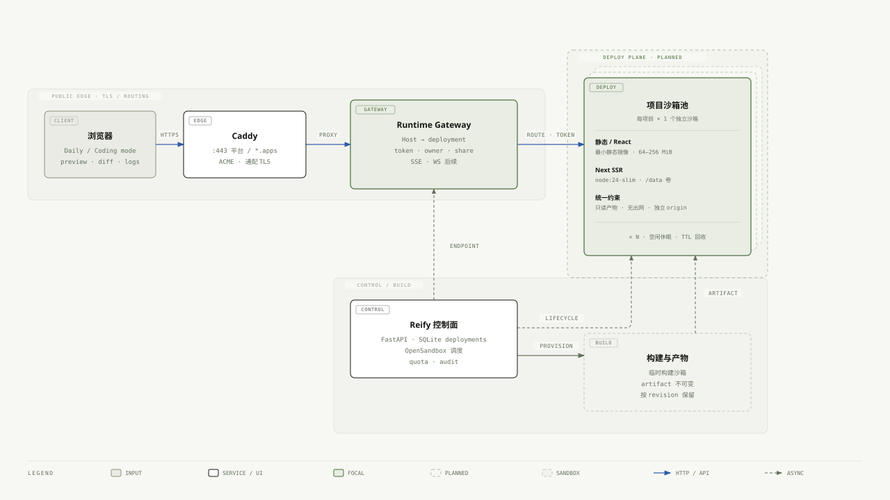

# Reify 架构设计文档

> 状态：v2.0.0 · 代码基线 2026-10-25 · 线上实例：独立部署环境
> 部署目录：`/data/reify-deploy`；容器：`reify` / `reify-caddy` / `reify-sandbox`；网络：`reify-net`
> 本文的「当前架构」以仓库代码、部署脚本和线上只读核查为准；第 5 章是「每项目独立轻量沙箱」目标架构，其中静态/React 的按项目运行时（P1）已落地，Runtime Gateway 与每项目独立 origin 仍待实施。
>
> 相关文档：[产品设计](reify-design-2026-10-24.md) · [隔离设计](isolation-design.md) · [前端设计](frontend-react-ts-design.md)

---

## 0. 结论先行

Reify 是一个**单机优先的多用户生成式设计 Agent 平台**：用户用一句话提出需求，平台完成能力识别、创意简报、模板命中或通用生成、构建、自检、发布，并通过同一条 SSE 事件流把思考、文件 Diff、构建日志和运行状态呈现给前端。

当前线上架构可以概括为：

- **一个 FastAPI 应用**同时承担平台 API、Agent 编排、静态发布和沙箱调度；
- **一个 React SPA**（Vite + TypeScript）构建到 `web/dist`，由 FastAPI 同源托管；
- **SQLite + 用户目录**保存身份、项目、运行时记录和全部产物；
- **OpenSandbox（Docker runtime）**为 React/Next 提供源码构建沙箱，为 Next 提供独立的运行时沙箱；
- **静态/React 项目**目前由 FastAPI 直接托管在 `/p/{id}/`，还没有独立运行时沙箱；
- **Next 项目**拥有独立运行时沙箱，但仅通过 `:12889` 端口与平台隔离，尚未做到每项目独立 origin。

下一步方向已经明确：**每一个项目（静态、React、Next）都独立部署在一个最轻量沙箱中**，由运行时网关按项目路由，形成“一次项目 = 一次小部署”的统一部署模型。静态/React 的按项目运行时已落地；Runtime Gateway 与每项目独立 origin 仍是第 5 章的目标。

---

## 1. 架构原则

1. **逻辑分离、物理同源**：前端只通过 REST/SSE 访问后端；生产环境没有独立前端服务，`web/dist` 由 FastAPI 托管，降低单机部署和鉴权复杂度。
2. **确定性优先、模型兜底**：先命中内置模板和规则；未命中才调用 LLM 生成长尾页面；生成结果必须通过结构与交互自检，失败修复一次，仍失败回退模板。
3. **生成与执行分离**：平台进程不执行不可信源码，也不持有 `docker.sock`；构建/运行都交给独立沙箱，沙箱不继承平台密钥。
4. **一次项目 = 一次小部署**：项目不仅是文件目录，还应有 revision、构建产物、运行时、健康状态、发布与回滚点。当前 Next 已具备这条链路，静态/React 是下一步补齐对象。
5. **同一条事件流、两种看法**：日常模式看结果，编程模式看过程；两种模式复用同一条 SSE 事件流，不重跑 Agent。
6. **单机优先、可演进**：当前以一台 ECS + Docker 为边界；沙箱控制面和部署记录按可替换后端设计，未来可平滑迁移到 MicroVM、ACS 或多机调度。

---

## 2. 当前架构总览（已实现）

### 2.1 当前运行架构


> 图 1：当前运行架构。可编辑源：[reify-architecture.html](diagrams/reify-architecture.html)；矢量图：[reify-architecture.svg](diagrams/reify-architecture.svg)。

纯文本拓扑：

```text
平台流量
  浏览器 ──HTTPS──► Caddy :12888 ──HTTP──► FastAPI :12888
                                             ├─ React SPA（web/dist）
                                             ├─ /api/*（REST + SSE）
                                             ├─ /p/{id}/、/s/{token}/、/media/*
                                             └─ /apps/{id}/* ──► Next 运行时沙箱 :3000

SSR 流量
  浏览器 ──HTTPS──► Caddy :12889（只放行 /apps/*）──► FastAPI /apps/*

构建流量
  FastAPI ──内网 API──► OpenSandbox Server ──Docker──► 构建沙箱
                                                       └─ tar + base64 回传产物
```

### 2.2 分层职责

| 层 | 组件 | 职责 | 运行位置 |
|---|---|---|---|
| 接入层 | Caddy | HTTPS/ACME、80 跳转、平台与 SSR 两个 origin 的路由 | `reify-caddy` 容器 |
| 平台层 | FastAPI + React SPA | 鉴权、项目 API、SSE、Agent 编排、静态发布、SSR 代理、管理后台 | `reify` 容器 |
| 生成层 | `server/agent.py`、`server/templates/`、`server/llm.py`、`server/media.py` | 能力识别、创意简报、模板、长尾生成、自检、Refine、图片/视频生成 | 平台进程内 |
| 执行层 | OpenSandbox Server + 构建/运行时沙箱 | 源码构建、Next standalone 运行、资源与生命周期管理 | `reify-sandbox` + 动态沙箱 |
| 数据层 | SQLite `reify.db` + `data/users/` | 用户、会话、项目、运行时、审计、源码与产物 | 宿主机 `data/` |
| 外部服务 | OpenAI 兼容模型、图片/视频模型 | 创意简报、长尾生成、局部 Patch、媒体生成 | 平台进程直连 |

### 2.3 请求与发布拓扑

**平台请求**

```text
GET /、/projects、/admin
  → FastAPI 返回 React SPA
GET /api/projects、/api/projects/{id}/events
  → 鉴权 → owner 校验 → JSON / SSE
GET /p/{id}/、/s/{token}/、/media/{id}/...?k=...
  → 静态文件或媒体资产
```

**Next SSR 请求**

```text
浏览器 → Caddy :12889 → FastAPI /apps/{id}/*
  → owner 校验 → 反向代理到该项目的 Next 运行时沙箱 :3000
  → 运行时不存在或未运行时返回可诊断错误
```

**发布路径**

| 路径 | 内容 | 访问控制 | 适用 |
|---|---|---|---|
| `/p/{project_id}/` | 静态目录、React `dist/` | 登录 + owner | 工作台预览 |
| `/s/{share_token}/` | 静态/React 只读副本 | 高熵 token | 公开分享，可撤销 |
| `/media/{project_id}/...?k=` | 图片/视频资产 | capability key | 供 CSP 沙箱页面加载 |
| `/apps/{project_id}/` | Next 运行时 | 登录 + owner；仅 `:12889` | SSR 应用 |

> 当前限制：`:12889` 只是端口级隔离，不是设计稿中的“每项目子域名 origin”。同主机不同端口不隔离 Cookie，生成应用仍可能覆盖平台 Cookie，造成登出类拒绝服务；真正的子域名隔离要等 Runtime Gateway（见第 5 章）。

---

## 3. 核心模块

### 3.1 Web 工作台（`frontend/`）

- 技术栈：React 19.1 + TypeScript 5.8 + Vite 6.3；构建输出 `web/dist`，由 FastAPI 同源托管。
- 页面：登录/注册、首页 Composer、项目库、项目工作台、管理后台。
- 工作区双模式：
  - **日常模式**：结果预览、验收清单、部署/运行时状态；
  - **编程模式**：文件树、逐行 Diff、终端日志、实时预览。
- 数据获取：REST `/api/*` + `useTaskStream` 消费 SSE；断线后按 `seq` 续传。
- 安全：生成页面只通过 iframe + CSP `sandbox` 展示，不插入平台 DOM；分享链接使用高熵 token。

### 3.2 平台服务（`server/main.py`）

FastAPI 同时是 API 网关和应用服务器，主要职责：

| 领域 | 端点/能力 | 说明 |
|---|---|---|
| 身份 | `/api/auth/register`、`login`、`logout`、`logout-all`、`me`、`password` | 自助注册、scrypt 密码、服务端 Session、Origin 校验 |
| 项目 | `GET/POST/PATCH/DELETE /api/projects` | 列表、创建、重命名/编辑、删除、owner 校验 |
| 实时事件 | `GET /api/projects/{id}/events?after=` | SSE，支持断线按序号续传 |
| 生成与修改 | `POST /api/projects/{id}/refine`、`/deploy` | 二次修改、重新发布 |
| 运行时 | `GET /api/projects/{id}/runtime`、`start`、`stop` | Next 运行时生命周期 |
| 发布 | `/p/`、`/s/`、`/media/`、`/apps/` | 静态预览、公开分享、媒体、SSR 代理 |
| 下载 | `GET /api/projects/{id}/bundle` | 项目打包下载 |
| 管理 | `/api/admin/users`、`status`、`revoke-sessions`、`audit` | 用户管理、会话撤销、审计 |
| 健康 | `GET /api/health` | 返回版本、LLM、沙箱可达性 |
| SPA | `GET /{path:path}` 兜底 | 非 API 路径返回 React 入口 |

平台容器资源：2 vCPU / 4 GiB / 512 PIDs，`cap-drop ALL`、`no-new-privileges`；不挂载 `docker.sock`。

### 3.3 生成编排（`server/agent.py`）

Reify 不是“自由 ToolCall Agent”，而是**确定性流水线 + 受控 LLM 介入点**：

```text
一句话
  → 规则识别 capability（游戏/网站/图片/视频/简历/攻略/编程）
  → 规则选择 stack（static / react / next）
  → 5 段式流水线：
       1. 理解需求 + 创意简报（规则默认值 + 可选 LLM）
       2. 生成骨架 / 源码（内置模板或 LLM 长尾）
       3. 生成真实产物（媒体生成 / React、Next 沙箱构建）
       4. 补齐数据、说明、构建信息
       5. 自检 → 发布（静态 / 分享 / Next 运行时）
  → SSE 持续推送每一步
```

**5 段流水线的事件对应**

| 阶段 | 产物/动作 | 主要事件 |
|---|---|---|
| 1 理解与方向 | capability、标题、创意简报 | `task_started`、`intent`、`plan`、`thinking`、`step_started/done` |
| 2 骨架/源码 | `index.html`、React/Next 源码、媒体素材 | `tool_call`、`file_diff`、`asset_created` |
| 3 构建/生成 | 静态页面、`dist/`、`.next/standalone`、媒体画廊 | `build_started`、`build_log`、`build_done/failed`、`runtime_built`、`preview_ready` |
| 4 补齐交付 | `build.json`、`deploy.json`、README、结构化数据 | `tool_call`、`file_diff` |
| 5 自检/发布 | 检查项、静态发布、SSR 就绪 | `verify`、`deployed`、`done`、`error` |

**生成策略**

- **能力识别**：关键词规则（`server/templates/library.py:classify`），避免为分类引入一次模型调用。
- **技术栈路由**（`server/stacks.py`）：
  - 非网站能力 → `static`；
  - 明确 Next/SSR → `next`；明确 React/Vite → `react`；
  - 个人网站/作品集/博客 → `react`（沙箱可用时）；公司/工作室/产品官网 → `static`；
  - 沙箱不可用时回退 `static`；显式源码栈且沙箱不可用时返回 503。
- **确定性优先**：游戏内置贪吃蛇、俄罗斯方块、飞机大战、打砖块引擎；网站/简历/攻略/编程有内置模板；长尾需求才走 LLM。
- **自检**：静态页面检查 DOCTYPE、viewport、内容完整性、交互脚本、能力特有结构（canvas、打印样式、行程切换、代码演示等）；React/Next 检查构建产物；编程项目额外执行 `py_compile`。
- **失败回退**：长尾生成未通过自检时回退内置模板；构建失败直接报错，不部署半成品。
- **媒体**：图片/视频走外部模型，下载后落到项目 `assets/`，页面只负责画廊/播放器；不把临时 URL 直接交付。
- **Refine**：静态项目走 HTML 局部 Patch；React/Next 走源码 Patch → 重新构建 → Next 蓝绿切换；失败保留原版本。

### 3.4 内置模板与能力

| 能力 | 默认 stack | 产物 | 说明 |
|---|---|---|---|
| 小游戏 | `static` | 单文件 `index.html` | 内置引擎 + 自定义 Canvas 玩法 |
| 网站 | `static` / `react` / `next` | 模板 HTML / `dist/` / standalone | 自动路由，用户不可见技术栈 |
| 简历 | `static` | 单文件 HTML | A4 打印、ATS 可读 |
| 旅游攻略 | `static` | 单文件 HTML | 按天切换、预算与路线 |
| 编程 | `static` | `index.html` + `main.py` | 代码与可视化、Python 语法检查 |
| 图片 | `static`（媒体型） | 画廊 + `assets/` | 外部图像模型 |
| 视频 | `static`（媒体型） | 播放器 + `assets/` | 异步视频任务 |
| 适配（历史） | `static` | 多尺寸画板 | 仅保留历史项目兼容，不再新建 |

React/Next 脚手架固定 `package.json`、`package-lock.json`、构建脚本和 Next `output: 'standalone'`，避免模型自由发明工程配置；安装依赖统一 `--ignore-scripts`。

### 3.5 沙箱与运行时

#### 3.5.1 控制面

- 独立部署 **OpenSandbox Server 1.1.1**（Docker runtime），只有它持有 `/var/run/docker.sock`；
- `reify` 应用容器不持有 `docker.sock`，通过内网 API Key 调用沙箱控制面；
- 沙箱 Server 同时接入 `reify-net` 与默认 `bridge`，使用 `resolve_internal = true` 代理到沙箱 execd；
- 构建端口范围 `41000-42000` 绑定到 bridge 网关地址，不直接暴露公网。

#### 3.5.2 构建沙箱

| 项 | 当前实现 |
|---|---|
| 镜像 | `node:24-bookworm-slim` |
| 资源 | 1 vCPU；内存默认 2 GiB，Next 构建线上使用 4 GiB |
| 生命周期 | TTL 15 分钟；构建完成立即销毁 |
| 并发 | 默认 2，按用户限制 1 个源码构建 |
| 命令 | `npm ci --ignore-scripts`（有 lockfile）或 `npm install --ignore-scripts` → `npm run build` |
| 出网 | 设计为 npm registry allowlist；**55 因 egress sidecar 无法启动，当前实际为 `open`** |
| 产物 | React `dist/`；Next `.next/standalone`；tar + base64 回传 |
| 上限 | React 30 MB；Next 120 MB；超限失败 |
| 失败处理 | `build_failed` 事件；不部署半成品；Next 保留旧运行时 |

#### 3.5.3 Next 运行时沙箱

| 项 | 当前实现 |
|---|---|
| 镜像 | `node:24-bookworm-slim` |
| 启动 | `PORT=3000 HOSTNAME=0.0.0.0 NODE_ENV=production node server.js` |
| 资源 | 1 vCPU / 1 GiB |
| 存储 | 产物只读运行；项目 `runtime-data/` 绑定到沙箱 `/data` |
| 网络 | 默认无出网（`REIFY_SANDBOX_EGRESS != open` 时）；55 因全局 `open`，运行时沙箱实际有出网 |
| 健康检查 | `GET /` 200，最多 90 秒 |
| 生命周期 | 空闲 10 分钟停止；TTL 1 小时；Docker runtime 是冷停止/冷启动，不是 MicroVM pause/resume |
| 切换 | 新 revision 先起新沙箱，健康后停旧沙箱，实现蓝绿 |
| 配额 | 每用户最多 2 个活跃运行时；全局上限尚未在代码中强制 |

#### 3.5.4 React 与 Next 的分工

| 能力 | React | Next |
|---|---|---|
| 构建沙箱 | 需要 | 需要 |
| 构建命令 | `vite build` | `next build` |
| 产物 | `dist/` 静态文件 | `.next/standalone` |
| 运行时沙箱 | 不需要 | 需要 |
| 访问 | `/p/{id}/` 静态路由 | `/apps/{id}/` 反代到 Node |
| 适用 | 纯前端站点 | 需要服务端接口/SSR 的全栈应用 |

> 平台 UI 的 React 与生成项目的 React 是两套代码：前者是 `frontend/` 固定工作台，后者是 `workspace/` 里按模板生成的项目。

### 3.6 数据与持久化

**SQLite（`data/reify.db`，WAL）**

| 表 | 作用 |
|---|---|
| `users` | 账号、scrypt 密码哈希、角色、禁用状态、token_version |
| `sessions` | 会话令牌哈希、过期、撤销、最近活动 |
| `projects` | 项目归属、能力、stack、标题、状态、revision、分享、asset_key、结果 |
| `runtimes` | 项目运行时：revision、sandbox_id、endpoint、状态、端口、活动时间 |
| `audit_log` | 注册/登录、项目创建/修改/部署、运行时启停、分享、管理员操作 |
| `meta` | 迁移与内部元数据 |

**文件布局**

```text
data/
  reify.db
  users/{uid}/projects/{pid}/
    meta.json              # 项目元数据 + owner_id + asset_key
    events.jsonl           # 完整 SSE 事件流（断线续传）
    workspace/             # 源码与静态产物
      index.html
      dist/                # React 构建产物
      runtime/             # Next standalone 产物
      runtime.prev/        # 上一版运行时产物（蓝绿回滚）
      assets/v{n}/         # 图片/视频资产
      build.json           # 构建信息
      deploy.json          # 发布清单
    runtime-data/          # Next 运行时持久化卷
```

- 服务重启后从 SQLite 恢复任务列表；中断状态标记为 `interrupted`，不会假装仍在运行。
- `meta.json` 原子写入；`events.jsonl` 追加写入；产物安装采用 staging → 原子 rename，失败保留上一版。
- 部署脚本在升级前备份 SQLite（含 WAL/SHM）；`data/` 与密钥不进入镜像。
- 每用户默认 50 个项目 / 1 GB 存储；删除项目时级联清理运行时记录与目录。

### 3.7 安全与隔离现状

| 层 | 目标 | 当前手段 | 缺口 |
|---|---|---|---|
| L0 身份 | 知道“是谁” | 自助注册、scrypt、服务端 Session、Origin/CSRF、限流 | — |
| L1 数据 | 只触达自己的项目 | 每用户目录、DB owner 索引、所有入口 owner 校验、统一 404 | — |
| L2 执行 | 不可信代码不碰主机/密钥/其他项目 | 独立构建沙箱、drop capabilities、`no-new-privileges`、资源限额、不注入平台密钥、构建后销毁 | 55 构建/运行时出网均为 `open`，无白名单 |
| L3 运行时 | 全栈应用独立进程与网络 | 每项目 Next 运行时沙箱；静态/React 可按项目 nginx 运行时（`REIFY_STATIC_RUNTIME=opensandbox`）、空闲/TTL 回收 | 静态运行时需显式开启；只有每用户配额，无全局调度与运行时指标 |
| L4 发布 | 可访问但不越权 | owner-only、capability URL、可撤销分享、SSR 独立端口 | 只有 IP + 端口，不是每项目子域名 origin |

其他已落地控制：

- 登录态 Cookie：HttpOnly + Secure + SameSite=Lax；写请求校验 Origin。
- 分享：静态/React 自动签发 `/s/{token}/`，可撤销；Next 分享暂未开放。
- 审计：关键动作写入 `audit_log`；管理员可禁用账号、撤销全部会话。
- 配额：项目数、存储、并发任务、源码构建、运行时数量；具体环境变量见 [`.env.example`](../.env.example)。
- 生成页面：iframe + CSP `sandbox`，不能读取平台 Cookie 或同源 API。
- 平台容器：`cap-drop ALL`、`no-new-privileges`、PID/内存/CPU 限额；容器内用户与根文件系统仍待收紧。

**已知风险**：

1. Next 运行时与平台同主机、不同端口；Cookie 不按端口隔离，仍有覆盖/DoS 风险。
2. 55 的构建与运行时沙箱出网均为 `open`；虽然沙箱无平台密钥且构建后销毁，但没有网络白名单。
3. 静态/React 项目仍由平台进程直接托管，没有独立运行时资源边界。
4. 运行时全局并发上限、存储清理、构建失败自动重试尚未完全落地。
5. 沙箱是 Docker 容器级隔离，弱于 MicroVM；不适合作为强多租户生产隔离的最终形态。

### 3.8 部署拓扑与运维

**线上容器（2026-10-25 只读核查）**

| 容器 | 镜像 | 端口 | 资源/说明 |
|---|---|---|---|
| `reify-caddy` | `caddy:2.10.2-alpine` | `80`、`12888`、`12889` | HTTPS/ACME、平台与 SSR 路由 |
| `reify` | `reify-app:latest` | 仅内网 `12888` | 2 vCPU / 4 GiB / 512 PIDs，`cap-drop ALL` |
| `reify-sandbox` | `opensandbox/server:release-1.1.1` | 仅内网 `8080` | 唯一持有 `docker.sock`，Docker runtime |

- 网络：`reify-net`；`reify-sandbox` 额外加入 `bridge`，以便回连沙箱 execd。
- 宿主机：`/data` 挂在部署目录；线上 `data/` 约 273 MB；平台健康接口返回 `version=2.0.0`、`llm=true`、`sandbox.reachable=true`。
- 常驻内存：平台约 50 MiB、Caddy 约 40 MiB、Sandbox Server 约 140 MiB（实测，随负载变化）。
- 资源预算：仅静态模板/通用生成 2C2G；完整 React/Next + 1–2 个 SSR 运行时建议 4–8C / 16 GB / 60 GB 磁盘。

**部署流程（`deploy_remote.sh`）**

```text
本地
  → tar 同步源码到 /data/reify-deploy（排除 .git、data、secrets、node_modules）
  → 远端 docker build reify-app
  → 从镜像提取 web/dist 到部署目录
  → 备份 SQLite
  → 重建 reify 与 reify-caddy（保留 reify-sandbox）
  → 等待 HTTPS 健康检查与鉴权门禁
```

- 环境文件：`.auth.env`、`.sandbox.env`、`.llm.env` 合并为 600 权限的 `.runtime.env`，通过 `docker --env-file` 注入。
- 静态资源改动通常立即生效；Python/模板改动需 `docker restart reify`；依赖变更需重建镜像。
- Sandbox 配置在 `/data/reify-deploy/sandbox/config.toml`，修改后需重建 `reify-sandbox`。
- 数据库备份位于 `/data/reify-deploy/backups/`；不要用 `rsync --delete` 覆盖部署目录。

### 3.9 质量保障

- 后端单测：`pytest`（隔离、stack 策略、游戏题材、长尾生成、Web UI 等）。
- 前端：Vitest 单测 + `tsc` 类型检查 + Vite 构建。
- E2E：本地真实 uvicorn + Chrome + mock LLM；源码沙箱用例覆盖 React/Next；线上回归通过 `REIFY_E2E_BASE` 指定实例。
- 生成工程构建验证：`tests/e2e_typescript_scaffolds.py` 对 React/Next 模板执行真实 `npm ci + build`。
- 浏览器用例：`tests/e2e_browser.py`；沙箱与 Refine：`tests/e2e_react_sandbox.py`、`e2e_next_ssr.py`、`e2e_refine.py`。

---

## 4. 关键数据流

### 4.1 创建到发布

```text
POST /api/projects
  → 配额检查 → 创建 Task（owner、stack、asset_key、share_token）
  → 异步 run_task
      └─ SSE: task_started / intent / plan
  → 阶段 1：brief（规则 + LLM）
  → 阶段 2：写文件（file_diff 实时推送）
  → 阶段 3：
      static  → 渲染 HTML
      react   → 沙箱构建 → dist → /p/
      next    → 沙箱构建 → standalone → runtime sandbox → /apps/
      media   → 外部模型 → 下载资产 → 画廊/播放器
  → 阶段 4：补齐交付文件
  → 阶段 5：verify → deploy → done
```

### 4.2 二次修改

```text
POST /api/projects/{id}/refine
  → 静态：LLM 返回 HTML 局部 Patch → 结构自检 → 重新发布
  → React/Next：LLM 返回源码 Patch → 写入 workspace
                 → 重新构建
                 → React：原子替换 dist
                 → Next：新运行时健康 → 切换 → 停旧运行时
  → 失败：保留原版本，推送 refine_failed
```

### 4.3 SSE 事件契约

事件统一带 `seq`、`type`、`ts`，完整写入 `events.jsonl`；客户端可用 `after` 续传。

| 分组 | 事件 |
|---|---|
| 任务/计划 | `task_started`、`intent`、`plan`、`step_started`、`thinking`、`step_done` |
| 工具/文件 | `tool_call`、`tool_result`、`file_diff`、`asset_created` |
| 构建 | `build_started`、`build_log`、`build_done`、`build_failed`、`runtime_built` |
| 运行时 | `runtime_starting`、`runtime_ready`、`runtime_stopped`、`runtime_error` |
| 媒体 | `media_progress` |
| 发布/结束 | `preview_ready`、`deployed`、`verify`、`done`、`error` |
| 修改 | `refine_started`、`refine_failed` |

---

## 5. 目标架构：每项目独立轻量沙箱（P1 已落地）

> 状态：P1 基础版本已落地。静态/React 项目可按项目启动 nginx 运行时，`/p/` 与 `/s/` 不再回退本地文件；Runtime Gateway、每项目子域名 origin 仍待实施。
> 本节保留目标基线与迁移路径；镜像、资源和域名仍会随 P2/P3 演进调整。

### 5.1 为什么需要这一步

当前 `static` / `react` 项目由 FastAPI 直接托管：没有独立运行时、没有独立资源边界、没有独立生命周期，也无法为每个项目提供独立 origin。Next 已经有运行时沙箱，但它是唯一特例。

目标是把部署模型统一为：

> **每个项目 = 一个 revision = 一份不可变产物 = 一个独立轻量沙箱 = 一个独立访问入口。**

收益：

- **隔离**：每个项目独立网络命名空间/进程/资源，不再和平台进程共享文件与 CPU。
- **生命周期**：按访问启动、空闲休眠、TTL 回收；不再让所有静态项目常驻平台进程。
- **独立 origin**：每个项目一个子域名，生成应用的 Cookie/JS 无法触达平台 API。
- **一致性**：静态、React、Next 走同一条“构建 → 产物 → 沙箱 → 健康 → 路由”链路。
- **可观测**：每次部署都有 deployment id、状态、健康、冷启动和资源指标。
- **可回滚**：产物不可变，蓝绿切换，旧版本保留一个 revision。

### 5.2 目标部署架构



> 图 2：目标部署架构（P1 基础版本已落地，P2 为目标）。可编辑源：[reify-architecture.html](diagrams/reify-architecture.html)；矢量图：[reify-sandbox-deployment.svg](diagrams/reify-sandbox-deployment.svg)。

目标拓扑：

```text
平台
  app.example.com ──► Caddy ──► Reify 平台（UI/API/SSE/控制面）

项目
  p-{id}.apps.example.com ──► Caddy ──► Runtime Gateway
                                         ├─ 校验访问 token / 项目归属
                                         ├─ 解析 deployment → sandbox endpoint
                                         └─ 反向代理到项目沙箱

项目沙箱池
  ├─ static  沙箱：最小静态服务器 + 只读产物
  ├─ react   沙箱：最小静态服务器 + 只读 dist
  └─ next    沙箱：node:24-slim + standalone + /data 卷

支撑面
  构建沙箱（临时）──► 产物存储 ──► 项目沙箱（只读挂载）
  OpenSandbox 控制面：创建 / 健康检查 / 休眠 / 唤醒 / 销毁
  SQLite：deployments / projects / runtimes / audit
```

### 5.3 沙箱分级（建议基线）

| 项目类型 | 运行时镜像 | 启动方式 | 目标资源 | 网络 | 存储 |
|---|---|---|---|---|---|
| `static` | 最小静态服务器（Caddy Alpine / busybox httpd / 自建 scratch） | 静态文件服务 | 0.1 vCPU / 64–128 MiB | 默认无出网 | 只读产物 |
| `react` | 同上（只需静态服务） | 静态文件服务 | 0.1–0.25 vCPU / 128–192 MiB | 默认无出网 | 只读 `dist/` |
| `next` | `node:24-bookworm-slim` 或更小的 Node 运行时 | `node server.js` | 1 vCPU / 512 MiB–1 GiB | 默认无出网 | 只读产物 + `/data`（≤100 MB） |
| 构建 | `node:24-bookworm-slim` | `npm ci` + `npm run build` | 1–2 vCPU / 2–4 GiB | 仅 npm registry | 临时，构建后销毁 |

“最轻量”的含义：

- 运行时镜像**不包含构建工具链**，只包含启动产物所需的最小依赖；
- 静态/React 不需要 Node 常驻，直接用最小静态服务器；
- 只读根文件系统、非 root、`cap-drop ALL`、`no-new-privileges`；
- 每个沙箱独立 CPU/内存/PID 限额与网络命名空间；
- 不注入任何平台密钥；项目自有环境变量后续单独加密注入；
- 空闲休眠、TTL 回收；默认无出网，确有需要时按项目开白名单。

> 以上数字是目标基线，需在真实宿主上压测冷启动、内存和并发后再定版。

### 5.4 生命周期与蓝绿发布

```text
draft
  → building（构建沙箱）
  → deploying（创建/更新项目沙箱）
  → running（健康检查通过）
  → sleeping（空闲超时）
  → running（下次访问唤醒）
  → stopped / destroyed（TTL 或删除）

任意阶段失败 → error
  → 重建；上一版可用产物/运行时保留为回滚点
```

流程要点：

1. 构建在临时沙箱完成，产物写入不可变 artifact 目录。
2. 创建新 revision 的项目沙箱，只读挂载产物，写入独立数据卷。
3. 健康检查通过后，网关原子切换路由到新沙箱；旧沙箱保留一个 revision。
4. 切换成功后异步销毁旧沙箱；构建/启动失败不切换。
5. 访问触发冷启动；空闲 10 分钟休眠；TTL 1 小时；可配置预热点。

### 5.5 数据模型扩展

在现有 `projects` / `runtimes` 之上新增 **deployments** 概念（可先作为 `runtimes` 的扩展字段，成熟后独立表）：

```sql
deployments(
  id TEXT PRIMARY KEY,
  project_id TEXT NOT NULL REFERENCES projects(id) ON DELETE CASCADE,
  revision INTEGER NOT NULL,
  stack TEXT NOT NULL,                 -- static | react | next
  image TEXT NOT NULL,
  artifact_path TEXT NOT NULL,
  sandbox_id TEXT,
  endpoint TEXT,
  status TEXT NOT NULL,                -- building | deploying | running | sleeping | stopped | error
  health TEXT,
  cpu TEXT,
  memory TEXT,
  last_active_at TEXT,
  error TEXT,
  created_at TEXT NOT NULL
);
```

- 每次生成/修改产生一个 deployment id；发布记录与项目 revision 绑定。
- 产物目录不可变：`artifacts/{project_id}/{revision}/`；项目沙箱只读挂载。
- 运行时数据卷独立：`runtime-data/{project_id}/`；删除项目时按策略回收。
- 现有 `runtimes` 表可平滑迁移为“当前激活 deployment 的索引”。
- 当前 P1 实现未新建 `deployments` 表：先扩展 `runtimes`（`kind`、`expires_at`、`stopped_at`、`stop_reason`），一行表示项目当前/最近一次运行时；deployment 历史表留待 P2。

### 5.6 Runtime Gateway 与每个项目独立 origin

**前提：域名。** 当前只有 IP，没有域名，无法做每项目子域名与通配证书。

目标：

```text
平台：  https://app.example.com
项目：  https://p-{project_id}.apps.example.com
证书：  *.apps.example.com（DNS-01 通配）
```

网关职责：

- 按 `Host` 解析项目 → 查 deployment → 校验会话/短期 token/分享 token；
- 校验 owner 或分享权限，拒绝跨用户访问；
- 反向代理到项目沙箱端口，透传 SSE/流式响应；
- 注入 `X-Forwarded-*`，保留应用自身 Host；
- 平台与项目不同 origin，平台 Cookie 不会发送给项目；
- 后续支持 WebSocket、自定义域名、项目级访问策略。

访问方式：

- 工作台打开项目时生成 5 分钟短期 HMAC token，跳转 `https://p-{id}.apps.example.com/?t=...`；
- 网关校验后设置该子域名的短期 HttpOnly Cookie；
- 分享使用独立 `share_token`，可撤销；Next 分享与静态项目共用同一套网关逻辑；
- 平台 `:12888` 不再暴露项目内容，`/p/` 仅作为过渡期的同源预览。

**在域名就绪前**：不要把静态/React 直接迁到“同源路径沙箱”并称为 origin 隔离；那只能获得资源隔离，不能获得 Cookie 隔离。可以先做资源沙箱，但公网入口仍保持现状。

### 5.7 配额、调度与可观测性

| 维度 | 目标 |
|---|---|
| 每用户活跃项目沙箱 | 2（休眠不计入） |
| 全局活跃项目沙箱 | 8（按宿主容量调整） |
| 超限策略 | LRU 休眠，访问时唤醒 |
| 每用户构建并发 | 1 |
| 全局构建并发 | 2 |
| 每项目源码 | ≤5 MB |
| 每项目产物 | ≤120 MB |
| 每项目数据卷 | ≤100 MB |
| 每用户存储 | 1 GB |
| 空闲休眠 | 10 分钟 |
| 运行时 TTL | 1 小时 |
| 冷启动目标 | 静态 ≤1 s；Next ≤5 s（首字节，待压测） |

指标建议：

```text
build_success_rate
time_to_first_usable
cold_start_p95
runtime_availability
sandbox_start_failure_rate
isolation_violations = 0
cost_per_project
```

每个 deployment 都要能回答：谁在何时部署了什么、产物是哪个 revision、当前跑在哪个沙箱、健康状态、最近访问、失败原因、如何回滚。

### 5.8 迁移路径

| 阶段 | 内容 | 验收 |
|---|---|---|
| **P0 当前收口** | 修复 egress allowlist；强制每用户/全局运行时配额；补运行时指标与清理策略；准备域名 | 构建沙箱只能访问 npm registry；超限可回收；域名可用 |
| **P1 部署模型统一（基础版本已落地）** | 扩展 `runtimes`；把静态/React 先放进轻量沙箱，但仍走平台 `/p/` 同源路径 | 静态/React 不再由平台进程直接读文件；资源隔离生效；行为不回退 |
| **P2 独立 origin** | Caddy 泛解析 + Runtime Gateway + 短期 token；静态/React/Next 全部按子域名访问；分享统一走网关 | 每项目独立 origin；跨项目/跨用户不可互访；应用读不到平台 Cookie |
| **P3 强隔离与弹性** | OpenSandbox Firecracker / ACS Agent Sandbox；pause/resume；多机调度；按秒计费 | MicroVM 级隔离；休眠唤醒；可水平扩展 |

**P1 是低风险切入点**：先获得资源隔离和统一生命周期，不改变用户访问路径；**P2 才解决 origin 隔离**，需要域名与网关一起上线。

### 5.9 待定决策

1. 静态/React 沙箱镜像：Caddy Alpine、busybox httpd，还是自建 scratch 静态服务器？
2. 项目沙箱是“首次访问创建”还是“发布后常驻 + 空闲休眠”？冷启动预算多少？
3. 每个项目是否允许出网？默认拒绝后，哪些项目类型可以申请白名单？
4. Runtime Gateway 放在 FastAPI 内还是独立进程？独立进程更容易做长连接和隔离，但多一个部署单元。
5. 产物存储是否继续用宿主目录，还是引入对象存储？
6. Next 是否继续作为高级旁路，还是逐步成为默认全栈路径？
7. 迁到 MicroVM 的触发条件：项目数、租户隔离要求，还是单机资源瓶颈？

---

## 6. 已知边界与后续优先级

| 边界 | 现状 | 影响 | 优先级 |
|---|---|---|---|
| 域名 | 只有 IP | SSR 只能用端口隔离，无法做每项目 origin | P0 |
| 沙箱出网 | 55 实际 `open` | 构建/运行时沙箱无网络白名单 | P0 |
| 运行时配额 | 每用户有上限；全局未强制 | 大量运行时可能耗尽宿主 | P0 |
| 静态/React 沙箱 | 平台直接托管 | 无独立资源/生命周期 | P1 |
| 项目 origin | 平台与项目同主机（不同端口） | Cookie 覆盖/DoS 风险 | P2 |
| 沙箱隔离级别 | Docker 容器 | 弱于 MicroVM | P3 |
| Next 分享 | 未开放 | 分享能力不完整 | P2 |
| 可观测性 | 健康检查 + 审计 + 日志 | 缺指标/追踪/告警 | P1 |
| 数据 | 单机 SQLite | 备份/迁移/多机扩展受限 | P2 |
| 前后端发布 | 同一镜像/同一版本 | 前端无法独立发布 | P2（可选） |

**建议顺序**：先把“能安全地给别人用”补齐（域名、出网、配额），再做“每项目一个轻量沙箱”的部署模型统一，最后才考虑强隔离和弹性。

---

## 7. 附录

### A. 关键代码路径

| 模块 | 作用 |
|---|---|
| `server/main.py` | FastAPI 入口、鉴权、项目 API、SSE、静态发布、SSR 代理、分享、管理 |
| `server/auth.py` | 注册、登录、scrypt、服务端会话、限流、Origin 校验 |
| `server/db.py` | SQLite schema、用户/会话/项目/运行时/审计 |
| `server/events.py` | Task/Project、事件流、用户工作区、SSE 订阅 |
| `server/agent.py` | 五段式生成、React/Next 构建、二次修改、蓝绿切换 |
| `server/llm.py` | 创意 brief、局部 Patch、长尾页面/游戏生成 |
| `server/media.py` | 图片/视频模型调用与资产下载 |
| `server/stacks.py` | stack 解析、React/Next 意图识别与 static 回退 |
| `server/sandbox.py` | OpenSandbox 客户端、构建、产物打包与校验 |
| `server/runtime.py` | Next standalone 运行时、健康检查、空闲停止 |
| `server/tools.py` | 文件快照、原子写入、产物安装、静态部署 |
| `server/templates/` | 7 类能力模板 + Vite/React + Next TypeScript 脚手架 |
| `frontend/` | 平台工作台：React + TypeScript + Vite |
| `web/dist/` | 平台 UI 构建产物，由 FastAPI 托管 |
| `deploy_remote.sh` | 远程部署、镜像构建、容器编排、健康检查 |
| `Caddyfile` | 平台/SSR 双 origin、ACME、SSE 直通 |
| `docs/diagrams/` | 架构图 HTML/SVG 源文件 |

### B. 关键环境变量

| 变量 | 默认 | 说明 |
|---|---|---|
| `REIFY_DATA` | `./data` | SQLite 与用户工作区根目录 |
| `REIFY_DB` | `data/reify.db` | SQLite 路径 |
| `REIFY_SANDBOX` | `off` | `opensandbox` 启用源码构建 |
| `REIFY_SANDBOX_DOMAIN` | `127.0.0.1:8080` | Sandbox Server 内网地址 |
| `REIFY_SANDBOX_IMAGE` | `node:24-bookworm-slim` | 构建/运行时镜像 |
| `REIFY_SANDBOX_BUILD_MEMORY` | `2Gi` | 构建沙箱内存；Next 建议 `4Gi` |
| `REIFY_SANDBOX_EGRESS` | `allowlist` | `allowlist` / `open` |
| `REIFY_SANDBOX_EGRESS_ALLOW` | npm registry 列表 | 出网白名单 |
| `REIFY_SANDBOX_CONCURRENCY` | `2` | 全局构建并发 |
| `REIFY_RUNTIME_TTL` / `REIFY_RUNTIME_IDLE` | `3600` / `600` | Next 运行时最长存活 / 空闲停止 |
| `REIFY_SSR_PREVIEW` / `REIFY_SSR_PORT` | `0` / `12889` | `/apps/*` 预览开关与独立 origin 端口 |
| `REIFY_MAX_PROJECTS_PER_USER` | `50` | 每用户项目上限 |
| `REIFY_MAX_ACTIVE_PER_USER` | `2` | 每用户并发任务上限 |
| `REIFY_MAX_RUNTIME_PER_USER` | `2` | 每用户活跃运行时上限 |
| `REIFY_MAX_STORAGE_PER_USER` | `1073741824` | 每用户存储上限（1 GB） |

完整列表与密钥文件说明见 [`.env.example`](../.env.example) 与 [README](../README.md)。

### C. 术语

| 术语 | 含义 |
|---|---|
| capability | 能力类型：游戏/网站/图片/视频/简历/攻略/编程 |
| stack | 生成项目的技术栈：`static` / `react` / `next` |
| build sandbox | 临时源码构建沙箱，构建后销毁 |
| runtime sandbox | 常驻/可休眠的项目运行时沙箱（当前仅 Next） |
| project sandbox | 目标架构中每个项目独立拥有的轻量部署沙箱 |
| deployment | 一次项目 revision 的构建 + 沙箱 + 路由记录 |
| Runtime Gateway | 按项目子域名/token 校验并反代到项目沙箱的网关 |
| artifact | 不可变构建产物（`dist/` 或 `.next/standalone`） |

---

> 变更记录：2026-10-25 从“早期 Demo 规划稿”重写为 v2.0.0 实际架构，并加入“每项目独立轻量沙箱”的目标架构。历史产品设计见 [reify-design-2026-10-24.md](reify-design-2026-10-24.md)。
